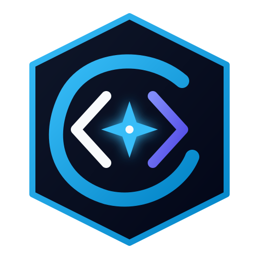

# CodePilot — Code. Learn. Build. Compete.

CodePilot is a commercial-grade, Python-driven developer platform combining online IDE capabilities, algorithmic problem challenges, live coding contests, video/PDF learning courses, Pilot AI assistant, and project workspaces.



## Features

- 💻 **VS Code-Grade Online IDE**: Multi-file tab manager, line numbers, syntax highlighting, minimap preview, and code execution simulator.
- 🐍 **Major Python Architecture (`codepilot/`)**: Pure Python engine core with AST syntax validator (`sandbox.py`), PEP8 linter & AI code reviewer (`ai_assistant.py`), Python models (`problem.py`, `user.py`), and CLI tool (`cli.py`).
- ⚡ **Pilot AI Assistant**: AI-driven code reviews, complexity breakdown, and experiment tracking.
- 🏆 **Contests & Leaderboards**: Biweekly contests, live countdown timer, penalty evaluation, and global ranking grids.
- 📖 **Developer Learning Center**: Video player UI with chapter markers and custom PDF document reader UI.
- 📊 **365-Day Activity Heatmap & Skill Tree**: Visual contribution heatmaps and interactive SVG node skill trees.
- 🧪 **Automated Test Suite**: Python `unittest` suite (7 tests) and in-browser automated unit test runner.

## Getting Started

### 1. View Frontend Web Application
Simply open `index.html` in your web browser, or launch a local static HTTP server:
```bash
python -m http.server 8000
```
Then navigate to `http://localhost:8000`.

### 2. Run Python CLI Tool
Execute commands via Python:
```bash
python -m codepilot list
python -m codepilot run solution.py
python -m codepilot review solution.py
```

### 3. Run Python Unit Test Suite
```bash
python -m unittest discover tests
```

### 4. Run Python Backend Server (Optional)
```bash
python backend/app.py
```
Backend API will start on `http://localhost:5000`.
